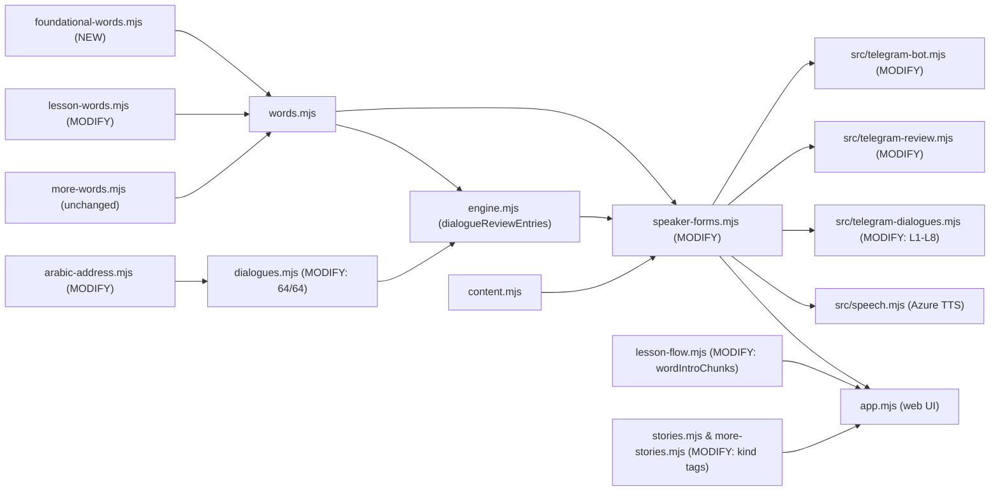

# Phase 3 Curriculum & Pedagogical Expansion Plan

> [!NOTE]
> **Review Document Only — No Implementation Code Modified Yet.**
> Baseline: `main` at commit `2769caf` (after PR #77 `c93de1b` and PR #78 `2769caf`).
> This document is prepared for engineering and six-language editorial review prior to opening a single combined implementation PR.

---

## 1. Goal Description

Phases 1 and 2 of the curriculum content quality audit — plus Phase 3.4 ([`dist/language-notes.mjs`](../dist/language-notes.mjs) enhancements) — have been completed and merged into `main` (PR #77 and PR #78).

This plan specifies the remaining four **Phase 3** workstreams to be delivered in **one combined PR** upon review sign-off:

1. **Foundational A1–A2 Vocabulary, Script Coverage & Lesson Load Balancing:** Add 106 foundational A1–A2 words (13 new groups in a new `dist/foundational-words.mjs` module + 4 entries appended to `relatives`), achieve 100% Level 1 Russian & Arabic alphabet primer coverage (`33/33` RU, `28/28` AR), move `weather` from Level 4 (`plans`) to Level 2 (`outdoors`), harmonize phrase-vs-vocabulary lexical drift, and chunk large `word-intro` screens to a maximum of 8 words per card while preserving the 8-question lesson contract and 1-lesson-per-group invariant.
2. **Full Web & 8-Level Telegram Dialogue Coverage:** Add 23 curated speaker-to-speaker exchanges to [`dist/dialogues.mjs`](../dist/dialogues.mjs) (`41/64` → `64/64` web lessons) and 5 multi-turn branching scenes to [`src/telegram-dialogues.mjs`](../src/telegram-dialogues.mjs) (`4` → `9` scenes covering all 8 levels).
3. **Reading-Depth Cognitive Tagging:** Tag 10 genuine higher-order comprehension questions (`inference`, `evidence`, `analysis`, `evaluation`, `application`) across 10 Level 4–8 regular stories in [`dist/stories.mjs`](../dist/stories.mjs) and [`dist/more-stories.mjs`](../dist/more-stories.mjs) so `readingDepthResult` activates on `100%` (`14/14`) of Level 6–8 stories and `17/20` of Level 4–8 stories without inflating pure factual recall questions.
4. **Vocabulary & Custom-Dialogue Speaker Forms:** Extend [`dist/speaker-forms.mjs`](../dist/speaker-forms.mjs) and stateless Telegram word handlers ([`src/telegram-review.mjs`](../src/telegram-review.mjs), [`src/telegram-bot.mjs`](../src/telegram-bot.mjs)) so speaker-voiced vocabulary entries (starting with `word-polite-words-3` Arabic `آسف` → `آسفة`) and any gendered 1st-person custom dialogue replies switch consistently across web UI, Lug‘at, spaced review, Telegram chat, and Azure neural TTS.

### Baseline vs. Target Metrics

| Dimension | Baseline (`2769caf`) | Phase 3 Target | Delta |
| :--- | :---: | :---: | :---: |
| Lessons / Lesson Phrases | `64` / `384` | `64` / `384` | Unchanged (save-safe) |
| Word Groups / Vocabulary Words | `68` / `489` | `81` / `595` | `+13` groups / `+106` words |
| Level 1 Alphabet Primer Coverage | `28/28` AR · `29/33` RU | **`28/28` AR · `33/33` RU** | Covers `Ф`, `Ъ`, `Э`, `Ю` |
| Max Words on One `word-intro` Screen | `16` words (`apartment`) | **`8` words** (balanced chunks) | Capped; `lessonQuestionTotal === 8` |
| Web Curated Dialogue Coverage | `41/64` lessons (`46` exchanges, `28` custom) | **`64/64` lessons** (`69` exchanges, `49` custom) | `+23` lessons (`+21` custom replies) |
| Telegram Branching Dialogue Scenes | `4` scenes (Levels 1, 3, 4) | **`9` scenes (Levels 1–8)** | `+5` scenes (Levels 2, 5, 6, 7, 8) |
| Stories with Cognitive `kind` Tags | `7/31` (`16/109` questions) | **`17/31`** (`26/109` questions) | `14/14` (100%) of Level 6–8 stories |
| `feminineForms` Scope | `phrases` only (`33` entries) | `phrases` + `words` + `dialogueReviewEntries` | End-to-end web, Telegram & TTS |

### Module Architecture & Dependency Flow



> [!TIP]
> **Zero Circular Imports Verified:** Neither [`dist/words.mjs`](../dist/words.mjs), [`dist/dialogues.mjs`](../dist/dialogues.mjs), nor [`dist/engine.mjs`](../dist/engine.mjs) imports [`dist/speaker-forms.mjs`](../dist/speaker-forms.mjs). Importing `words` and `dialogueReviewEntries` into [`dist/speaker-forms.mjs`](../dist/speaker-forms.mjs) keeps the module graph strictly acyclic.

---

## 2. User Review Required

Please review and sign off on these **7 architectural and linguistic decisions** before implementation begins.

> [!IMPORTANT]
> **Decision 1 — Personal Pronouns Cross-Language Collision Strategy (`pronouns` L1 + `everyday-verbs` L2)**
> Within any single level, [`test/catalog.test.mjs`](../test/catalog.test.mjs#L205-L211) enforces unique normalized `searchText()` answers in all 6 languages. Three natural language collisions occur if all personal pronouns sit in Level 1:
> - Uzbek (`u`) and Turkish (`o`) collapse `he`, `she`, and `that` into one word.
> - German `Sie` (formal *you*), `sie` (*she*), and `sie` (*they*) all lowercase to `'sie'`.
>
> **Proposed Design (Recommended):**
> - Place 6 entries in **Level 1 `pronouns`** (`introductions`): `I`, `you` (`siz`/`вы`/`أنتَ`/`siz`/`Sie`), `he / she` (`u`/`он / она`/`هو / هي`/`o`/`er / sie`), `we`, `this` (`bu`/`это`/`هذا`/`bu`/`dieses`), `that` (`o‘sha`/`то`/`ذلك`/`şu`/`jenes`).
> - Place **`they`** (`ular`/`они`/`هم`/`onlar`/`sie`) in **Level 2 `everyday-verbs`** (`home-chores`).
> - Note on `searchText`: Turkish `şu` (*that*, L1) normalizes to `'su'`, matching `word-food-1` (`su`, *water*, L3). Because they are at different levels and [`dist/vocabulary-review.mjs`](../dist/vocabulary-review.mjs#L12-L26) and [`src/telegram-bot.mjs`](../src/telegram-bot.mjs#L131-L136) already deduplicate cross-level distractors by `searchText()`, this causes zero runtime ambiguity.

> [!IMPORTANT]
> **Decision 2 — Month `May` vs. Modal `may` Level-Cap Constraint**
> [`test/catalog.test.mjs`](../test/catalog.test.mjs#L198-L204) enforces that any single-word English vocabulary entry appearing in a Level `N` phrase must be taught at `level <= N + 2`. Because Level 1 `polite-requests` uses modal *"May I..."*, the month **`May`** must sit at **Level `<= 3`**.
>
> **Proposed Design (Recommended):** Place **`months`** (`January`–`December`) at **Level 2 (`routine`)** right alongside `days` (`Monday`–`Sunday`), satisfying the level-cap invariant natively with no test workaround.

> [!WARNING]
> **Decision 3 — German `groß` Collision: New L1 `big` vs. Existing L6 `word-character-1` (`tall`)**
> [`test/lesson-words.test.mjs`](../test/lesson-words.test.mjs#L26-L39) enforces that no word in `lessonWordGroups` may match `searchText()` of *any* other word in `words` across *any* level. Existing Level 6 `word-character-1` ([`dist/lesson-words.mjs`](../dist/lesson-words.mjs#L120)) translates `tall` (`uz: baland bo‘yli`, `tr: uzun boylu`) as German `groß`, which collides with adding Level 1 `big` (`de: groß`).
> - **Option A (Recommended):** Update `word-character-1` German from `groß` → **`groß gewachsen`** (literally *"tall in stature"*, matching Uzbek `baland bo‘yli` and Turkish `uzun boylu`), reserving bare **`groß`** for Level 1 `big`.
> - **Option B:** Relax [`test/lesson-words.test.mjs`](../test/lesson-words.test.mjs#L26-L39) from global to per-level uniqueness (matching [`test/catalog.test.mjs`](../test/catalog.test.mjs#L205-L211)), keeping `groß` in both L1 and L6.

> [!WARNING]
> **Decision 4 — Arabic `corridor` (`word-building-words-2`) vs. `path` (`word-outdoors-2`) Collision**
> Lexical drift exists between `inside-a-building-5` (Arabic `ممرّ`, *corridor*) and `word-building-words-2` ([`dist/lesson-words.mjs`](../dist/lesson-words.mjs#L81), currently `رواق`). However, Level 2 `word-outdoors-2` (*path*) already uses bare **`ممرّ`** (and phrase `outdoors-3` uses `يمرّ الممرّ بين الأشجار`), so changing `word-building-words-2` to bare `ممرّ` fails cross-level uniqueness in [`test/lesson-words.test.mjs`](../test/lesson-words.test.mjs#L26-L39).
> - **Option A (Recommended):** Change `word-building-words-2` to **`ممرّ داخليّ`** (`mamarr dākhilī`, *indoor corridor*), reinforcing the exact root `ممرّ` taught in `inside-a-building-5` while remaining distinct from `word-outdoors-2` (`ممرّ`, *path*).
> - **Option B:** Change Level 2 `word-outdoors-2` and `outdoors-3` from `ممرّ` to **`درب`** (`darb`, *trail/path*), freeing bare `ممرّ` for Level 4 `word-building-words-2` (note: touches a Level 2 phrase and requires updating `word-orders.mjs` / TTS cache for `outdoors-3`).
> - **Option C:** Keep `رواق` on `word-building-words-2` as a valid MSA synonym (only harmonize `word-ordering-5` `أوصى` → `نصح` and `word-post-words-1` `posilka` → `jo‘natma`, which have zero collisions).

> [!IMPORTANT]
> **Decision 5 — Turkish Wording for `wife` and `husband` in `relatives`**
> Standard modern Turkish prefers gender-neutral `eş` (*spouse*) in polite speech, whereas `karı` can sound colloquial/abrupt in isolation and `hanım` can also mean *lady/Mrs.*.
> - **Option A (Recommended):** `husband` = **`koca`**, `wife` = **`hanım`** (or **`eş (kadın)`** / **`kadın eş`** if reviewers prefer explicit disambiguation without colloquial register).
> - **Option B:** `husband` = **`erkek eş`**, `wife` = **`kadın eş`** (explicit parallel pair; slightly textbook-like).
> - Please confirm preferred Turkish translations for both entries.

> [!IMPORTANT]
> **Decision 6 — Scope of Vocabulary `feminineForms` in [`dist/speaker-forms.mjs`](../dist/speaker-forms.mjs)**
> - **Option A (Recommended):** Add feminine forms **only** to speaker-voiced/first-person vocabulary entries — specifically `word-polite-words-3` (`آسف` → `آسفة`, `āsifa`, *"sorry"*) — plus any gendered 1st-person custom dialogue replies. Keep ordinary dictionary nouns and adjectives (`word-people-5..8`, `word-classroom-6..7`, `word-mood-1..6`, `word-feelings-*`, `word-character-*`) in standard lexicographic masculine singular citation form.
> - **Option B:** Also feminize human-role nouns (`student`, `teacher`, `friend`, `colleague`, `doctor`) and personal adjectives (`tired`, `happy`, `hungry`, `thirsty`, `ill`) when `speaker === 'f'`. *(Caution: significantly expands TTS cache surface and breaks dictionary citation conventions for non-1st-person glosses.)*

> [!NOTE]
> **Decision 7 — Multi-Card `word-intro` UX & Chunk Cap**
> Chunking `lessonVocabulary(unit)` with `max = 8` via balanced splitting (e.g., `14 → 7+7`, `16 → 8+8`, `20 → 6+7+7`, `22 → 7+7+8`) keeps `lessonQuestionTotal === 8` (pass mark `7/8`) and introduces every word before `word-meaning`.
> - **Question for UI/UX reviewers:** On lessons with 2–3 `word-intro` cards, should the header show a subtle numeric badge like `1 / 2` (appended to `lessonFlowWords` via `question.part` / `question.parts`, requiring zero new localized strings), or keep the current plain `lessonFlowWords` label? *(Recommended: append ` · 1/2` only when `parts > 1` so learners know how many word cards remain.)*

---

## 3. Open Questions & Reviewer Sign-Off Checklist

### Engineering Reviewers
1. Confirm **Decision 3** (`word-character-1` `groß gewachsen` vs. scoping [`test/lesson-words.test.mjs`](../test/lesson-words.test.mjs#L26-L39) to per-level uniqueness).
2. Confirm moving `weather` (`word-weather-1..8`) from Level 4 → Level 2 is acceptable for existing saves (same IDs, earlier unlock, zero orphaned cards; Level 2–3 learners gain 8 already-relevant words immediately).
3. Confirm whether [`docs/curriculum.md`](./curriculum.md) and [`docs/mixed-lessons.md`](./mixed-lessons.md) updates should land in the same PR.

### Native-Language Editorial Reviewers (`uz`, `en`, `ru`, `ar`, `tr`, `de`)
4. **Arabic (`ar`):** Sign off on **Decision 4** (`ممرّ داخليّ` vs. `درب`/`ممرّ` vs. `رواق`), verify `word-ordering-5` (`أوصى` → `نصح`), verify Arabic romanization and `feminineAddressee` entries for the 21 new custom dialogue replies, and verify Arabic `months` (`يناير`–`ديسمبر`, standard Pan-Arab/Egyptian-Gulf MSA vs. Levantine names).
5. **Turkish (`tr`):** Sign off on **Decision 5** (`husband` / `wife` translations) and verify lowercase month names (`ocak`–`aralık`, standard Turkish orthography outside dated phrases) and natural register across all 21 custom replies + 5 Telegram scenes.
6. **Uzbek (`uz`):** Verify `word-post-words-1` (`posilka` → `jo‘natma`), standard Latin orthography (`o‘`, `g‘`, `’` *tutuq belgisi*), and natural phrasing across `dist/foundational-words.mjs` (e.g., `bor bo‘lmoq` for *to have*, `shisha idish` for *bottle*).
7. **German (`de`):** Sign off on **Decision 3** (`groß gewachsen`), verify definite articles on all new nouns (`der`/`die`/`das`) and bare stems on ordinals (`erste`–`fünfte`, `letzte` vs. `der/die/das erste`).
8. **Russian (`ru`):** Verify naturalness of Level 1 alphabet-completing entries (`фотография`, `объяснять`, `это`, `любить`, `рюкзак`) and lexical stress placements in [`dist/russian-stress.mjs`](../dist/russian-stress.mjs).
9. **English (`en-US`):** Confirm `autumn` (unambiguous season) vs. `fall` in `seasons-and-time` and review all 23 new dialogue cues/replies and 10 reading-depth `kind` labels.

---

## 4. Proposed Changes

### Workstream 1: Foundational A1–A2 Vocabulary, Alphabet Coverage & `word-intro` Load Balancing

#### Save-Compatibility & Invariant Rules (Strictly Preserved)
- Existing word IDs (`'word-' + group.id + '-' + (index + 1)`) are **never** reordered, renamed, or removed.
- [`dist/more-words.mjs`](../dist/more-words.mjs) remains untouched at exactly `16 words/level` (`128` total), preserving [`test/catalog.test.mjs`](../test/catalog.test.mjs#L82-L107).
- Every word group of Level `L` maps to exactly one lesson of Level `L` in `lessonTopics` ([`test/lesson-words.test.mjs`](../test/lesson-words.test.mjs#L9-L24)).
- All 106 new words have been pre-verified via simulation for **zero** same-level `searchText()` collisions across all 6 languages, **zero** `moreWordGroups` English collisions, and **zero** `word.level <= min + 2` violations.

---

#### `[NEW]` `dist/foundational-words.mjs`

Exports `foundationalWordGroups` (**13 new word groups**, **102 new words**) using `text`, `phrase`, and `vocabulary` from [`dist/catalog.mjs`](../dist/catalog.mjs).

##### Full 6-Language Editorial Review Table (102 New Words + 4 Appended `relatives` = 106 Total)

<details>
<summary><strong>Level 1 — 6 New Groups (42 words): <code>pronouns</code>, <code>question-words</code>, <code>core-verbs</code>, <code>personal-items</code>, <code>core-adjectives</code>, <code>teens</code></strong></summary>

| Group → Lesson | `uz` | `en` | `ru` | `ar` | `tr` | `de` | `romanization` |
| :--- | :--- | :--- | :--- | :--- | :--- | :--- | :--- |
| `pronouns` → `introductions` | `men` | `I` | `я` | `أنا` | `ben` | `ich` | `anā` |
| `pronouns` → `introductions` | `siz` | `you` | `вы` | `أنتَ` | `siz` | `Sie` | `anta` |
| `pronouns` → `introductions` | `u` | `he / she` | `он / она` | `هو / هي` | `o` | `er / sie` | `huwa / hiya` |
| `pronouns` → `introductions` | `biz` | `we` | `мы` | `نحن` | `biz` | `wir` | `naḥnu` |
| `pronouns` → `introductions` | `bu` | `this` | `это` *(covers **Э**)* | `هذا` | `bu` | `dieses` | `hādhā` |
| `pronouns` → `introductions` | `o‘sha` | `that` | `то` | `ذلك` | `şu` | `jenes` | `dhālika` |
| `question-words` → `greetings` | `kim` | `who` | `кто` | `مَن` | `kim` | `wer` | `man` |
| `question-words` → `greetings` | `nima` | `what` | `что` | `ماذا` | `ne` | `was` | `mādhā` |
| `question-words` → `greetings` | `qayerda` | `where` | `где` | `أين` | `nerede` | `wo` | `ayna` |
| `question-words` → `greetings` | `qachon` | `when` | `когда` | `متى` | `ne zaman` | `wann` | `matā` |
| `question-words` → `greetings` | `nega` | `why` | `почему` | `لماذا` | `neden` | `warum` | `limādhā` |
| `question-words` → `greetings` | `qanday` | `how` | `как` | `كيف` | `nasıl` | `wie` | `kayfa` |
| `core-verbs` → `classroom-phrases` | `bo‘lmoq` | `to be` | `быть` | `كان` | `olmak` | `sein` | `kāna` |
| `core-verbs` → `classroom-phrases` | `bor bo‘lmoq` | `to have` | `иметь` | `ملك` | `sahip olmak` | `haben` | `malaka` |
| `core-verbs` → `classroom-phrases` | `bormoq` | `to go` | `идти` | `ذهب` | `gitmek` | `gehen` | `dhahaba` |
| `core-verbs` → `classroom-phrases` | `kelmoq` | `to come` | `приходить` | `جاء` | `gelmek` | `kommen` | `jāʾa` |
| `core-verbs` → `classroom-phrases` | `qilmoq` | `to do` | `делать` | `فعل` | `yapmak` | `machen` | `faʿala` |
| `core-verbs` → `classroom-phrases` | `ko‘rmoq` | `to see` | `видеть` | `رأى` | `görmek` | `sehen` | `raʾā` |
| `core-verbs` → `classroom-phrases` | `yaxshi ko‘rmoq` | `to like` | `любить` *(covers **Ю**)* | `أحبّ` | `sevmek` | `mögen` | `aḥabba` |
| `core-verbs` → `classroom-phrases` | `tushuntirmoq` | `to explain` | `объяснять` *(covers **Ъ**)* | `شرح` | `açıklamak` | `erklären` | `sharaḥa` |
| `personal-items` → `belongings` | `telefon` | `phone` | `телефон` *(has **Ф**)* | `هاتف` | `telefon` | `das Telefon` | `hātif` |
| `personal-items` → `belongings` | `fotosurat` | `photo` | `фотография` *(initial **Ф**)* | `صورة` | `fotoğraf` | `das Foto` | `ṣūra` |
| `personal-items` → `belongings` | `ryukzak` | `backpack` | `рюкзак` *(has **Ю**)* | `حقيبة ظهر` | `sırt çantası` | `der Rucksack` | `ḥaqībat ẓahr` |
| `personal-items` → `belongings` | `hamyon` | `wallet` | `кошелёк` | `محفظة` | `cüzdan` | `die Geldbörse` | `miḥfaẓa` |
| `personal-items` → `belongings` | `shisha idish` | `bottle` | `бутылка` | `زجاجة` | `şişe` | `die Flasche` | `zujāja` |
| `personal-items` → `belongings` | `piyola` | `cup` | `чашка` | `كوب` | `fincan` | `die Tasse` | `kūb` |
| `core-adjectives` → `colors` | `katta` | `big` | `большой` | `كبير` | `büyük` | `groß` | `kabīr` |
| `core-adjectives` → `colors` | `kichik` | `small` | `маленький` | `صغير` | `küçük` | `klein` | `ṣaghīr` |
| `core-adjectives` → `colors` | `yangi` | `new` | `новый` | `جديد` | `yeni` | `neu` | `jadīd` |
| `core-adjectives` → `colors` | `eski` | `old` | `старый` | `قديم` | `eski` | `alt` | `qadīm` |
| `core-adjectives` → `colors` | `yomon` | `bad` | `плохой` | `سيّئ` | `kötü` | `schlecht` | `sayyiʾ` |
| `core-adjectives` → `colors` | `oson` | `easy` | `лёгкий` | `سهل` | `kolay` | `einfach` | `sahl` |
| `core-adjectives` → `colors` | `qiyin` | `difficult` | `трудный` | `صعب` | `zor` | `schwierig` | `ṣaʿb` |
| `core-adjectives` → `colors` | `to‘g‘ri` | `correct` | `правильный` | `صحيح` | `doğru` | `richtig` | `ṣaḥīḥ` |
| `teens` → `numbers` | `o‘n bir` | `eleven` | `одиннадцать` | `أحد عشر` | `on bir` | `elf` | `aḥada ʿashar` |
| `teens` → `numbers` | `o‘n ikki` | `twelve` | `двенадцать` | `اثنا عشر` | `on iki` | `zwölf` | `ithnā ʿashar` |
| `teens` → `numbers` | `o‘n uch` | `thirteen` | `тринадцать` | `ثلاثة عشر` | `on üç` | `dreizehn` | `thalāthata ʿashar` |
| `teens` → `numbers` | `o‘n to‘rt` | `fourteen` | `четырнадцать` | `أربعة عشر` | `on dört` | `vierzehn` | `arbaʿata ʿashar` |
| `teens` → `numbers` | `o‘n olti` | `sixteen` | `шестнадцать` | `ستّة عشر` | `on altı` | `sechzehn` | `sittata ʿashar` |
| `teens` → `numbers` | `o‘n yetti` | `seventeen` | `семнадцать` | `سبعة عشر` | `on yedi` | `siebzehn` | `sabʿata ʿashar` |
| `teens` → `numbers` | `o‘n sakkiz` | `eighteen` | `восемнадцать` | `ثمانية عشر` | `on sekiz` | `achtzehn` | `thamāniyata ʿashar` |
| `teens` → `numbers` | `o‘n to‘qqiz` | `nineteen` | `девятнадцать` | `تسعة عشر` | `on dokuz` | `neunzehn` | `tisʿata ʿashar` |

</details>

<details>
<summary><strong>Level 2 — 3 New Groups + 4 Appended to <code>relatives</code> (32 new words; plus <code>weather</code> moved from L4)</strong></summary>

| Group → Lesson | `uz` | `en` | `ru` | `ar` | `tr` | `de` | `romanization` |
| :--- | :--- | :--- | :--- | :--- | :--- | :--- | :--- |
| `relatives` *(append #8–11)* → `family` | `uka` | `younger brother` | `младший брат` | `أخ أصغر` | `erkek kardeş` | `der jüngere Bruder` | `akh aṣghar` |
| `relatives` *(append #8–11)* → `family` | `singil` | `younger sister` | `младшая сестра` | `أخت صغرى` | `kız kardeş` | `die jüngere Schwester` | `ukht ṣughrā` |
| `relatives` *(append #8–11)* → `family` | `er` | `husband` | `муж` | `زوج` | `koca` *(Decision 5)* | `der Ehemann` | `zawj` |
| `relatives` *(append #8–11)* → `family` | `xotin` | `wife` | `жена` | `زوجة` | `hanım` *(Decision 5)* | `die Ehefrau` | `zawja` |
| `everyday-verbs` → `home-chores` | `ular` | `they` | `они` | `هم` | `onlar` | `sie` | `hum` |
| `everyday-verbs` → `home-chores` | `yashamoq` | `to live` | `жить` | `عاش` | `yaşamak` | `wohnen` | `ʿāsha` |
| `everyday-verbs` → `home-chores` | `ishlamoq` | `to work` | `работать` | `عمل` | `çalışmak` | `arbeiten` | `ʿamila` |
| `everyday-verbs` → `home-chores` | `o‘rganmoq` | `to learn` | `учить` | `تعلّم` | `öğrenmek` | `lernen` | `taʿallama` |
| `everyday-verbs` → `home-chores` | `bilmoq` | `to know` | `знать` | `عرف` | `bilmek` | `wissen` | `ʿarafa` |
| `everyday-verbs` → `home-chores` | `xohlamoq` | `to want` | `хотеть` | `أراد` | `istemek` | `wollen` | `arāda` |
| `everyday-verbs` → `home-chores` | `yemoq` | `to eat` | `есть` | `أكل` | `yemek yemek` | `essen` | `akala` |
| `everyday-verbs` → `home-chores` | `ichmoq` | `to drink` | `пить` | `شرب` | `içmek` | `trinken` | `shariba` |
| `months` → `routine` | `yanvar` | `January` | `январь` | `يناير` | `ocak` | `der Januar` | `yanāyir` |
| `months` → `routine` | `fevral` | `February` | `февраль` | `فبراير` | `şubat` | `der Februar` | `fibrāyir` |
| `months` → `routine` | `mart` | `March` | `март` | `مارس` | `mart` | `der März` | `māris` |
| `months` → `routine` | `aprel` | `April` | `апрель` | `أبريل` | `nisan` | `der April` | `abrīl` |
| `months` → `routine` | `may` | `May` | `май` | `مايو` | `mayıs` | `der Mai` | `māyū` |
| `months` → `routine` | `iyun` | `June` | `июнь` | `يونيو` | `haziran` | `der Juni` | `yūnyū` |
| `months` → `routine` | `iyul` | `July` | `июль` | `يوليو` | `temmuz` | `der Juli` | `yūlyū` |
| `months` → `routine` | `avgust` | `August` | `август` | `أغسطس` | `ağustos` | `der August` | `aghusṭus` |
| `months` → `routine` | `sentabr` | `September` | `сентябрь` | `سبتمبر` | `eylül` | `der September` | `sibtambir` |
| `months` → `routine` | `oktabr` | `October` | `октябрь` | `أكتوبر` | `ekim` | `der Oktober` | `uktūbar` |
| `months` → `routine` | `noyabr` | `November` | `ноябрь` | `نوفمبر` | `kasım` | `der November` | `nūfambir` |
| `months` → `routine` | `dekabr` | `December` | `декабрь` | `ديسمبر` | `aralık` | `der Dezember` | `dīsambir` |
| `seasons-and-time` → `telling-time` | `bahor` | `spring` | `весна` | `ربيع` | `ilkbahar` | `der Frühling` | `rabīʿ` |
| `seasons-and-time` → `telling-time` | `yoz` | `summer` | `лето` | `صيف` | `yaz` | `der Sommer` | `ṣayf` |
| `seasons-and-time` → `telling-time` | `kuz` | `autumn` | `осень` | `خريف` | `sonbahar` | `der Herbst` | `kharīf` |
| `seasons-and-time` → `telling-time` | `qish` | `winter` | `зима` | `شتاء` | `kış` | `der Winter` | `shitāʾ` |
| `seasons-and-time` → `telling-time` | `yil` | `year` | `год` | `سنة` | `yıl` | `das Jahr` | `sana` |
| `seasons-and-time` → `telling-time` | `kun` | `day` | `день` | `يوم` | `gün` | `der Tag` | `yawm` |
| `seasons-and-time` → `telling-time` | `daqiqa` | `minute` | `минута` | `دقيقة` | `dakika` | `die Minute` | `daqīqa` |
| `seasons-and-time` → `telling-time` | `tun` | `night` | `ночь` | `ليل` | `gece` | `die Nacht` | `layl` |

</details>

<details>
<summary><strong>Level 3 &amp; Level 4 — 4 New Groups (32 words): <code>tens-and-hundreds</code> (L3), <code>health-and-care</code> (L4), <code>plans-and-frequency</code> (L4), <code>ordinals</code> (L4)</strong></summary>

| Group → Lesson | `uz` | `en` | `ru` | `ar` | `tr` | `de` | `romanization` |
| :--- | :--- | :--- | :--- | :--- | :--- | :--- | :--- |
| `tens-and-hundreds` → `L3 market` | `qirq` | `forty` | `сорок` | `أربعون` | `kırk` | `vierzig` | `arbaʿūn` |
| `tens-and-hundreds` → `L3 market` | `ellik` | `fifty` | `пятьдесят` | `خمسون` | `elli` | `fünfzig` | `khamsūn` |
| `tens-and-hundreds` → `L3 market` | `oltmish` | `sixty` | `шестьдесят` | `ستّون` | `altmış` | `sechzig` | `sittūn` |
| `tens-and-hundreds` → `L3 market` | `yetmish` | `seventy` | `семьдесят` | `سبعون` | `yetmiş` | `siebzig` | `sabʿūn` |
| `tens-and-hundreds` → `L3 market` | `sakson` | `eighty` | `восемьдесят` | `ثمانون` | `seksen` | `achtzig` | `thamānūn` |
| `tens-and-hundreds` → `L3 market` | `to‘qson` | `ninety` | `девяносто` | `تسعون` | `doksan` | `neunzig` | `tisʿūn` |
| `tens-and-hundreds` → `L3 market` | `yuz` | `one hundred` | `сто` | `مئة` | `yüz` | `hundert` | `miʾa` |
| `tens-and-hundreds` → `L3 market` | `ming` | `one thousand` | `тысяча` | `ألف` | `bin` | `tausend` | `alf` |
| `health-and-care` → `L4 appointment` | `shifokor` | `doctor` | `врач` | `طبيب` | `doktor` | `der Arzt` | `ṭabīb` |
| `health-and-care` → `L4 appointment` | `dori` | `medicine` | `лекарство` | `دواء` | `ilaç` | `die Medizin` | `dawāʾ` |
| `health-and-care` → `L4 appointment` | `og‘riq` | `pain` | `боль` | `ألم` | `ağrı` | `der Schmerz` | `alam` |
| `health-and-care` → `L4 appointment` | `isitma` | `fever` | `температура` | `حمّى` | `ateş` | `das Fieber` | `ḥummā` |
| `health-and-care` → `L4 appointment` | `yurak` | `heart` | `сердце` | `قلب` | `kalp` | `das Herz` | `qalb` |
| `health-and-care` → `L4 appointment` | `oshqozon` | `stomach` | `желудок` | `معدة` | `mide` | `der Magen` | `maʿida` |
| `health-and-care` → `L4 appointment` | `ko‘z` | `eye` | `глаз` | `عين` | `göz` | `das Auge` | `ʿayn` |
| `health-and-care` → `L4 appointment` | `quloq` | `ear` | `ухо` | `أذن` | `kulak` | `das Ohr` | `udhun` |
| `health-and-care` → `L4 appointment` | `og‘iz` | `mouth` | `рот` | `فم` | `ağız` | `der Mund` | `fam` |
| `health-and-care` → `L4 appointment` | `burun` | `nose` | `нос` | `أنف` | `burun` | `die Nase` | `anf` |
| `plans-and-frequency` → `L4 plans` | `tez orada` | `soon` | `скоро` | `قريبًا` | `yakında` | `bald` | `qarīban` |
| `plans-and-frequency` → `L4 plans` | `bo‘sh vaqt` | `free time` | `свободное время` | `وقت الفراغ` | `boş zaman` | `die Freizeit` | `waqt al-farāgh` |
| `plans-and-frequency` → `L4 plans` | `birga` | `together` | `вместе` | `معًا` | `birlikte` | `zusammen` | `maʿan` |
| `plans-and-frequency` → `L4 plans` | `doim` | `always` | `всегда` | `دائمًا` | `her zaman` | `immer` | `dāʾiman` |
| `plans-and-frequency` → `L4 plans` | `ba’zan` | `sometimes` | `иногда` | `أحيانًا` | `bazen` | `manchmal` | `aḥyānan` |
| `plans-and-frequency` → `L4 plans` | `tez-tez` | `often` | `часто` | `غالبًا` | `sık sık` | `oft` | `ghāliban` |
| `plans-and-frequency` → `L4 plans` | `hech qachon` | `never` | `никогда` | `أبدًا` | `asla` | `nie` | `abadan` |
| `plans-and-frequency` → `L4 plans` | `allaqachon` | `already` | `уже` | `بالفعل` | `zaten` | `schon` | `bi-l-fiʿl` |
| `ordinals` → `L4 inside-a-building` | `birinchi` | `first` | `первый` | `أوّل` | `birinci` | `erste` | `awwal` |
| `ordinals` → `L4 inside-a-building` | `ikkinchi` | `second` | `второй` | `ثانٍ` | `ikinci` | `zweite` | `thānin` |
| `ordinals` → `L4 inside-a-building` | `uchinchi` | `third` | `третий` | `ثالث` | `üçüncü` | `dritte` | `thālith` |
| `ordinals` → `L4 inside-a-building` | `to‘rtinchi` | `fourth` | `четвёртый` | `رابع` | `dördüncü` | `vierte` | `rābiʿ` |
| `ordinals` → `L4 inside-a-building` | `beshinchi` | `fifth` | `пятый` | `خامس` | `beşinci` | `fünfte` | `khāmis` |
| `ordinals` → `L4 inside-a-building` | `oxirgi` | `last` | `последний` | `أخير` | `son` | `letzte` | `akhīr` |

</details>

##### Level 1 Russian Alphabet Primer Proof ([`dist/alphabet.mjs`](../dist/alphabet.mjs))
- **`Ф`**: `фотография` (lexical initial, `rank === 0`) + `телефон` in `personal-items`
- **`Э`**: `это` (lexical initial, `rank === 0`) in `pronouns`
- **`Ъ`**: `объяснять` (medial hard sign — Russian words never begin with `ъ`) in `core-verbs`
- **`Ю`**: `любить` in `core-verbs` + `рюкзак` in `personal-items`
- Result: **`letterExample()` returns non-null for all 28/28 Arabic and all 33/33 Russian letters from Level 1 onward.**

---

#### `[MODIFY]` [`dist/words.mjs`](../dist/words.mjs)
- Import `foundationalWordGroups` from `./foundational-words.mjs` and append them via `wordGroups.push(...moreWordGroups, ...lessonWordGroups, ...foundationalWordGroups);` ([`dist/words.mjs`](../dist/words.mjs#L312)).
- Change `weather` ([`dist/words.mjs`](../dist/words.mjs#L110)) from Level `4` → Level `2` (keeping identical IDs `word-weather-1`..`word-weather-8`).
- Add `<link rel="modulepreload" href="./foundational-words.mjs">` to [`dist/index.html`](../dist/index.html) alongside the other catalog modules.

---

#### `[MODIFY]` [`dist/lesson-words.mjs`](../dist/lesson-words.mjs)
- **Append 4 entries** (`word-relatives-8`..`word-relatives-11`: `younger brother`, `younger sister`, `husband`, `wife`) to the end of `relatives` ([`dist/lesson-words.mjs`](../dist/lesson-words.mjs#L22-L30)).
- **Lexical harmonization:**
  - `word-ordering-5` ([`dist/lesson-words.mjs`](../dist/lesson-words.mjs#L44)): Arabic `أوصى` (`awṣā`) → **`نصح`** (`naṣaḥa`), matching `meal-1`.
  - `word-post-words-1` ([`dist/lesson-words.mjs`](../dist/lesson-words.mjs#L88)): Uzbek `posilka` → **`jo‘natma`**, matching `post-office-1`/`2`.
  - `word-building-words-2` ([`dist/lesson-words.mjs`](../dist/lesson-words.mjs#L81)): Pending **Decision 4** (recommended: `ممرّ داخليّ` / `mamarr dākhilī`).
  - `word-character-1` ([`dist/lesson-words.mjs`](../dist/lesson-words.mjs#L120)): Pending **Decision 3** (recommended: German `groß` → `groß gewachsen`).
- **Update `lessonTopics`** ([`dist/lesson-words.mjs`](../dist/lesson-words.mjs#L179-L209)) to assign all 13 new groups and re-home `weather` from `L4 plans` → `L2 outdoors`. Note: `L6 feelings` (`story`) and `L7 connectors` (`reflection`) remain in place as cross-lesson B1 support groups so no artificial B1 vocabulary bloat is introduced.

---

#### `[MODIFY]` [`dist/lesson-flow.mjs`](../dist/lesson-flow.mjs) and [`dist/app.mjs`](../dist/app.mjs)
- Add balanced `wordIntroChunks(entries, max = 8)` in [`dist/lesson-flow.mjs`](../dist/lesson-flow.mjs#L67-L74):
  ```js
  function wordIntroChunks(entries, max = 8) {
    const count = Math.ceil(entries.length / max);
    return Array.from({ length: count }, (_, index) =>
      entries.slice(
        Math.floor(index * entries.length / count),
        Math.floor((index + 1) * entries.length / count)
      )
    );
  }
  ```
- Replace the single `word-intro` object with `...wordIntroChunks(vocabulary).map((chunk, index, chunks) => ({ task: 'word-intro', entry: chunk[0], examples: chunk, core: false, ...(chunks.length > 1 ? { part: index + 1, parts: chunks.length } : {}) }))`.
- Because `isQuestion` excludes `'word-intro'` ([`dist/lesson-flow.mjs`](../dist/lesson-flow.mjs#L10)), **`lessonQuestionTotal(activities)` stays strictly `8`** (pass mark `7/8`) across all 64 lessons × 30 directions, and [`dist/app.mjs`](../dist/app.mjs#L1586-L1589) automatically calls `introduceVocabulary(course(), question.examples)` as each card is advanced, scheduling 100% of lesson vocabulary before `word-meaning`.
- Optional UI polish ([`dist/app.mjs`](../dist/app.mjs#L1356-L1359), per **Decision 7**): when `question.parts > 1`, render `instruction: t('lessonFlowWords') + ' · ' + fmt(question.part) + '/' + fmt(question.parts)`.

##### Before vs. After `word-intro` Card Load (Affected Lessons)

| Lesson | Before (`words` / cards) | After (`words` / chunk split) | Groups Mapped |
| :--- | :---: | :---: | :--- |
| `L1 greetings` | `6` (1 card) | `12` (`6 + 6`) | `greeting-words`, `question-words` |
| `L1 introductions` | `8` (1 card) | `14` (`7 + 7`) | `people`, `pronouns` |
| `L1 numbers` | `14` (1 card) | `22` (`7 + 7 + 8`) | `numbers`, `teens` |
| `L1 classroom-phrases` | `8` (1 card) | `16` (`8 + 8`) | `classroom`, `core-verbs` |
| `L1 colors` | `6` (1 card) | `14` (`7 + 7`) | `colors`, `core-adjectives` |
| `L1 polite-requests` | `14` (1 card) | `14` (`7 + 7`) | `polite-words`, `actions` |
| `L1 belongings` | `8` (1 card) | `14` (`7 + 7`) | `everyday-objects`, `personal-items` |
| `L2 family` | `7` (1 card) | `11` (`5 + 6`) | `relatives` (11w) |
| `L2 routine` | `8` (1 card) | `20` (`6 + 7 + 7`) | `days`, `months` |
| `L2 apartment` | `16` (1 card) | `16` (`8 + 8`) | `home`, `apartment` |
| `L2 free-time` | `11` (1 card) | `11` (`5 + 6`) | `hobbies`, `linking-basics` |
| `L2 outdoors` | `6` (1 card) | `14` (`7 + 7`) | `outdoors`, `weather` *(moved from L4)* |
| `L2 home-chores` | `8` (1 card) | `16` (`8 + 8`) | `household-chores`, `everyday-verbs` |
| `L2 wellbeing` | `14` (1 card) | `14` (`7 + 7`) | `mood`, `body-and-rest` |
| `L2 telling-time` | `8` (1 card) | `16` (`8 + 8`) | `time`, `seasons-and-time` |
| `L3 market` | `8` (1 card) | `16` (`8 + 8`) | `food`, `tens-and-hundreds` |
| `L4 directions` | `9` (1 card) | `9` (`4 + 5`) | `city` |
| `L4 plans` | `8` (`weather`) | `8` (`8`) | `plans-and-frequency` |
| `L4 appointment` | `6` (1 card) | `16` (`8 + 8`) | `appointments`, `health-and-care` |
| `L4 inside-a-building` | `6` (1 card) | `12` (`6 + 6`) | `building-words`, `ordinals` |
| *Remaining 44 lessons* | `6`–`8` (1 card) | `6`–`8` (1 card) | Unchanged |

---

### Workstream 2: Full Web (64/64) & 8-Level Telegram Dialogues

#### `[MODIFY]` [`dist/dialogues.mjs`](../dist/dialogues.mjs) and [`dist/arabic-address.mjs`](../dist/arabic-address.mjs)

Add **1 vetted speaker-to-speaker exchange** to each of the 23 currently missing lessons (`2` phrase-reusing exchanges with explicit non-overlapping distractors + `21` custom 6-language exchanges with Arabic reading aids and `dialogue-<unitId>-1` stable IDs). Total exchanges rise from `46` → **`69`**, `dialogueReviewEntries` from `28` → **`49`**, and web lesson coverage from `41/64` → **`64/64`**.

| Level | Lesson | Type | Cue Phrase | Proposed Reply (`en` preview; full 6 languages in PR) | Distractors / Notes |
| :---: | :--- | :---: | :--- | :--- | :--- |
| 1 | `numbers` | Custom | `5`: *"Could you repeat the number?"* | *"Of course: zero, five, two, nine."* | Default unit phrases (`1,2,3,4,6`); spoken digits avoid TTS punctuation issues |
| 1 | `belongings` | Custom | `4`: *"Is this key yours?"* | *"Yes, it’s mine. Thank you!"* | Default (`1,2,3,5,6`); masc. *key* aligns across RU (`мой`), AR (`هو`), DE (`der`) |
| 1 | `where-things-are` | Custom | `6`: *"Where is my pencil?"* | *"It’s next to the box."* | Default (`1–5`); distinct from *pen* (`1`) and *bag* (`2`) |
| 2 | `family` | Custom | `5`: *"Where does your family live?"* | *"They live in another city."* | Default (`1–4,6`); distinct from *friend nearby* (`3`) |
| 2 | `apartment` | Custom | `6`: *"Could you close the door?"* | *"Of course, I’ll close it now."* | Default (`1–5`) |
| 2 | `free-time` | Custom | `6`: *"I’m learning to swim."* | *"That’s great! Where do you practice?"* | Default (`1–5`); register 2sg AR addressee in `arabic-address.mjs` |
| 2 | `home-chores` | Custom | `4`: *"Can you take out the trash?"* | *"Sure, I’ll do it right away."* | Default (`1–3,5,6`) |
| 2 | `telling-time` | Custom | `6`: *"What time do you finish?"* | *"I finish at six o’clock."* | Default (`1–5`) |
| 3 | `market` | Custom | `2`: *"Are these tomatoes fresh?"* | *"Yes, they arrived this morning."* | Default (`1,3–6`) |
| 3 | `dietary-needs` | Custom | `4`: *"Do you have a dish that is not spicy?"* | *"Yes, the vegetable soup is not spicy."* | Default (`1–3,5,6`) |
| 4 | `directions` | Custom | `4`: *"Is it far?"* | *"No, it’s about a five-minute walk."* | Default (`1–3,5,6`); avoids `Turn left`/`Go straight` overlap on Cue 1 |
| 4 | `plans` | Reused | `1`: *"Do you have time tomorrow?"* | `3`: *"I’m free after work."* | Explicit distractors `[4, 5, 6]` (excludes `2`: *"Let’s meet at six."*) |
| 4 | `city-services` | Custom | `4`: *"Do I need an appointment?"* | *"No, you can wait in line at the counter."* | Default (`1–3,5,6`); register 2sg AR addressee in `arabic-address.mjs` |
| 5 | `shopping` | Custom | `1`: *"Do you have a smaller size?"* | *"Let me check in the back for you."* | Default (`2–6`); register 2sg AR addressee (`لكَ`/`لكِ`) in `arabic-address.mjs` |
| 5 | `hotel` | Custom | `2`: *"Is breakfast included in the price?"* | *"Yes, it is served from seven to ten."* | Default (`1,3–6`); reused in Telegram L5 `hotel` scene |
| 6 | `story` | Custom | `1`: *"Yesterday I missed the bus."* | *"Oh no, how did you get there in the end?"* | Default (`2–6`); register 2sg AR addressee in `arabic-address.mjs` |
| 6 | `compare` | Reused | `4`: *"Which option would you choose if you had more time?"* | `6`: *"Both options are convenient, but I’d choose the train."* | Explicit distractors `[1, 2, 5]`; inherits `compare-6` feminine speaker form |
| 6 | `describing-people` | Custom | `5`: *"At first he seems shy."* | *"Yes, but he opens up once you get to know him."* | Default (`1–4,6`); register 2sg AR addressee in `arabic-address.mjs` |
| 7 | `reflection` | Custom | `2`: *"I’d like to feel more confident when I speak."* | *"Practicing a little every day really helps with that."* | Default (`1,3–6`) |
| 7 | `instructions` | Custom | `6`: *"Could you show me how you did it?"* | *"Sure, I’ll walk you through it step by step."* | Default (`1–5`); register 2sg AR addressee (`أريك`/`لكَ`) in `arabic-address.mjs` |
| 7 | `learning-strategies` | Custom | `1`: *"Although I understand the text, I struggle to express myself freely."* | *"Try summarizing each paragraph aloud in your own words."* | Default (`2–6`); register 2sg AR addressee in `arabic-address.mjs` |
| 8 | `feedback` | Custom | `3`: *"Could we move the background information to the beginning?"* | *"Yes, that will make the structure much clearer."* | Default (`1,2,4–6`) |
| 8 | `short-update` | Custom | `6`: *"I would like five minutes at the next meeting."* | *"Sure, I’ll add your update to the agenda."* | Default (`1–5`); register 2sg AR addressee (`تحديثك`) in `arabic-address.mjs` |

Every custom reply with 2nd-person singular Arabic forms will be registered in [`dist/arabic-address.mjs`](../dist/arabic-address.mjs#L5-L94) so `arabicUsage()` automatically attaches feminine addressee hints on web and Telegram.

---

#### `[MODIFY]` [`src/telegram-dialogues.mjs`](../src/telegram-dialogues.mjs)

Add **5 branching multi-turn scenes** for Levels 2, 5, 6, 7, and 8 (reaching **9 scenes across all 8 levels**). Every turn uses curated curriculum lines, localized 6-language `goal` prompts, and respects `speaker` (`'m'`/`'f'`) without mutating global catalog entries:

| Level | Scene (`unit.id`) | Branching Flow | Exercises Feminine Forms? |
| :---: | :--- | :--- | :---: |
| 2 | `wellbeing` | `start`: choose `wellbeing-3` (*thirsty*) → `'drink'` (cue `dialogue-wellbeing-1` → `wellbeing-4`) **OR** `wellbeing-2` (*tired*) → `'rest'` (`wellbeing-6`); distractor `wellbeing-1` | Yes (`wellbeing-2`, `-3`, `-6`) |
| 5 | `hotel` | `start`: choose `hotel-1` (*reservation*) → `'breakfast'` (`hotel-2`, closing `dialogue-hotel-1`) **OR** `hotel-4` (*suitcase*) → `'checkout'` (`hotel-3`, localized closing *"Before eleven o’clock."* ); distractor `hotel-5` | Yes (`hotel-5` distractor) |
| 6 | `compare` | `start` (cue `compare-4`): choose `compare-6` (*choose train*) → `'reason'` (`compare-3`) **OR** `compare-2` (*leave earlier*) → `'budget'` (`compare-5`); distractor `compare-1` | Yes (`compare-2`, `-6`) |
| 7 | `problems` | `start`: choose `problems-1` (*mistake*) → `'explain'` (`problems-2` → `'followup'`) **OR** `problems-2` (*two beds*) → `'followup'` (cue `dialogue-problems-1` → `problems-4` / `problems-6`); distractor `problems-5` | Yes (`problems-2`) |
| 8 | `decisions` | `start` (cue `decisions-2`): `decisions-3` (*smaller version*) → `'agree'` (choose `decisions-4` → `'record'` (`decisions-5`) **OR** `decisions-5` → `'done'`); distractors `decisions-1`, `decisions-6` | Yes (`decisions-4`) |

---

### Workstream 3: Reading-Depth Cognitive `kind` Tags on Level 4–8 Stories

#### `[MODIFY]` [`dist/stories.mjs`](../dist/stories.mjs) and [`dist/more-stories.mjs`](../dist/more-stories.mjs)

[`dist/app.mjs`](../dist/app.mjs#L1659-L1664) computes `depthResult` using `thinkingKinds = new Set(['inference', 'evidence', 'analysis', 'evaluation', 'synthesis', 'application'])`. To preserve assessment integrity, **only** questions requiring genuine higher-order reasoning are tagged; pure factual recall stories (`L4 library-card`, `L5 platform`, `L5 missed-coach`) remain honestly at `'detail'`.

| Level | Story (`file:line`) | Q# | Question Prompt (`en`) → Correct Answer | Proposed `kind` | Rationale |
| :---: | :--- | :---: | :--- | :---: | :--- |
| 4 | `pharmacy-queue` ([`stories.mjs:496`](../dist/stories.mjs#L496)) | Q4 | *"What did she do so that the next visit would be easier?"* → *"She noted the hours."* | `application` | Applies lesson from setback to prevent future failure |
| 4 | `new-meeting-time` ([`more-stories.mjs:63`](../dist/more-stories.mjs#L63)) | Q3 | *"Why did they not meet at four?"* → *"There was too little time before closing."* | `analysis` | Evaluates scheduling constraint against closing window |
| 5 | `baggage-report` ([`more-stories.mjs:82`](../dist/more-stories.mjs#L82)) | Q4 | *"Why does Samir wait for confirmation?"* → *"An expected time does not confirm actual arrival."* | `evidence` | Distinguishes projection from verified arrival evidence |
| 6 | `keys` ([`stories.mjs:98`](../dist/stories.mjs#L98)) | Q2 | *"What helped Nuri remember where the keys were?"* → *"He remembered handing his friend a book."* | `inference` | Reconstructs causal memory chain from indirect clue |
| 6 | `route-home` ([`stories.mjs:233`](../dist/stories.mjs#L233)) | Q2 | *"Why did Emil suggest walking to the station?"* → *"He wanted to avoid getting stuck in traffic."* | `analysis` | Weighs transport trade-off (walk vs. road congestion) |
| 6 | `rain-barrel` ([`stories.mjs:418`](../dist/stories.mjs#L418)) | Q3 | *"Why did the barrel come in handy the following week?"* → *"They had water for the seedlings even without new rain."* | `application` | Connects stored solution to subsequent dry spell |
| 7 | `leaking-tap` ([`stories.mjs:444`](../dist/stories.mjs#L444)) | Q3 | *"How could the photo help the technician?"* → *"He could bring the right spare part."* | `inference` | Infers practical operational effect of diagnostic photo |
| 8 | `team` ([`stories.mjs:152`](../dist/stories.mjs#L152)) | Q3 | *"Why could Lea start the same day?"* → *"She understood the task and the first step."* | `inference` | Infers why clarification unlocked immediate action |
| 8 | `shelf-pilot` ([`stories.mjs:260`](../dist/stories.mjs#L260)) | Q3 | *"Why did the group decide to add a second shelf?"* → *"Most books found readers, and the shelf took little time."* | `evaluation` | Evaluates pilot results against initial effort concern |
| 8 | `meeting-notes` ([`stories.mjs:470`](../dist/stories.mjs#L470)) | Q3 | *"Why did Zarina say the map was still an open question?"* → *"The team still needed permission to use it."* | `evidence` | Identifies missing authorization prerequisite |

*(Already tagged in `main` and preserved unchanged: `old-photo` Q4, `mistake-notebook` Q4, `clear-request` Q3/Q4, `survey-decision` Q1/Q3/Q4, and all 3 extended stories.)*

---

### Workstream 4: Vocabulary & Custom-Dialogue Speaker Forms

#### `[MODIFY]` [`dist/speaker-forms.mjs`](../dist/speaker-forms.mjs)
- Import `words` from `./words.mjs` and `dialogueReviewEntries` from `./engine.mjs`.
- Add `'word-polite-words-3': { ar: 'آسفة', romanization: 'āsifa' }` (per **Decision 6**; plus any gendered 1st-person custom replies if introduced after editorial review of Workstream 2).
- Update `applySpeakerForms(form = 'm')` to iterate `[...phrases, ...words, ...dialogueReviewEntries]`, restoring exact original `text` and `romanization` snapshots on `'m'`/`undefined`.
- Export a pure read-only helper `textForSpeaker(entry, code, speaker = 'm')` so server-side Telegram modules never mutate global catalog objects or duplicate lookup logic:
  ```js
  export function textForSpeaker(entry, code, speaker = 'm') {
    return speaker === 'f' && feminineForms[entry?.id]?.[code]
      ? feminineForms[entry.id][code]
      : entry?.text?.[code];
  }
  ```

#### `[MODIFY]` [`src/telegram-review.mjs`](../src/telegram-review.mjs), [`src/telegram-bot.mjs`](../src/telegram-bot.mjs), [`src/telegram-dialogues.mjs`](../src/telegram-dialogues.mjs), [`src/telegram-private-practice.mjs`](../src/telegram-private-practice.mjs)
- **[`src/telegram-review.mjs`](../src/telegram-review.mjs#L27-L65):** In `buildChatRound(state, random, now)`, apply `textForSpeaker(entry, code, state.speaker)` when serializing `prompt`, `options`, `sources`, and `targets` (and in `answerParagraphs` feedback), so female speakers reviewing `word-polite-words-3` in Arabic see `آسفة` consistently with the Mini App and TTS.
- **[`src/telegram-bot.mjs`](../src/telegram-bot.mjs#L127-L147):** In `questionFor(s, ...)`, apply `textForSpeaker(w, code, s.speaker)` for quick-practice word prompts, options, and uniqueness checks.
- **[`src/telegram-dialogues.mjs`](../src/telegram-dialogues.mjs#L12-L13)** & **[`src/telegram-private-practice.mjs`](../src/telegram-private-practice.mjs#L20-L29):** Reuse `textForSpeaker` / `feminineForms` cleanly.
- **[`src/speech.mjs`](../src/speech.mjs#L19-L52):** Already resolves `feminineForms[id]?.[lang]` across `[...phrases, ...words, ...dialogueReviewEntries, ...storyLines, ...lessonExamples]` — no logic change needed, only targeted test coverage.

---

### Supporting Metadata, Documentation & Test Updates

#### `[MODIFY]` [`dist/russian-stress.mjs`](../dist/russian-stress.mjs)
- Add verified lexical stress entries for every newly introduced Russian word/form in `dist/foundational-words.mjs`, `dist/lesson-words.mjs`, `dist/dialogues.mjs`, and `src/telegram-dialogues.mjs`, ensuring **0** unstressed multisyllabic Russian words across the entire catalog.

#### `[MODIFY]` [`docs/curriculum.md`](./curriculum.md) & [`docs/mixed-lessons.md`](./mixed-lessons.md)
- Update catalog totals (`595` words, `81` word groups, `64/64` web dialogues, `9` Telegram scenes across Levels 1–8), document `dist/foundational-words.mjs`, document `word-intro` chunking (`<= 8` words/card), and note full Level 1 Arabic & Russian alphabet primer coverage.

#### `[MODIFY]` Test Suite Updates & New Regression Gates
| Test File | Updates & New Assertions |
| :--- | :--- |
| [`test/catalog.test.mjs`](../test/catalog.test.mjs) | Update `words.length` (`489 → 595`); keep `moreWordGroups` (`128`), per-level uniqueness, and `word.level <= min + 2` gates green |
| [`test/lesson-words.test.mjs`](../test/lesson-words.test.mjs) | Verify all `81` word groups map 1-to-1 to lessons; preserve uniqueness checks |
| [`test/lesson-flow.test.mjs`](../test/lesson-flow.test.mjs#L109-L118) | Assert every `word-intro` card has `1 <= examples.length <= 8`, all `word-intro` cards precede `word-meaning`, flattened `examples` equal `lessonVocabulary(unit)`, and `lessonQuestionTotal === 8` for all 64 lessons |
| [`test/dialogues.test.mjs`](../test/dialogues.test.mjs) | Update exchange count (`46 → 69`), custom count (`28 → 49`), and assert **`64/64` lessons** have curated exchanges + `dialogueReviewEntries.length === 49` |
| [`test/learning-depth.test.mjs`](../test/learning-depth.test.mjs) | Update `words.length` (`489 → 595`), assert `14/14` Level 6–8 stories have at least one non-`detail` cognitive tag |
| [`test/progression.test.mjs`](../test/progression.test.mjs) | Update `words.length` (`489 → 595`) |
| [`test/translation-quality.test.mjs`](../test/translation-quality.test.mjs) | Update `words.length` (`595`), `entries.length` (`1206`), and total text-field count (`9,852`); verify Arabic reading-aid 1-to-1 word alignment on every new word and custom reply |
| [`test/speaker-forms.test.mjs`](../test/speaker-forms.test.mjs) | Allow `words` and `dialogueReviewEntries` in `feminineForms`; verify `word-polite-words-3` toggles `آسف`/`آسفة` & `āsif`/`āsifa` cleanly, and verify stateless Telegram `questionFor` & `buildChatRound` respect `speaker: 'f'` without mutating `words` |
| [`test/azure-speech.test.mjs`](../test/azure-speech.test.mjs) | Verify `resolveAudio('word-polite-words-3', 'ar', 'f')` returns `آسفة` with `ar-SA-ZariyahNeural` |
| [`test/vocabulary.test.mjs`](../test/vocabulary.test.mjs) | Add regression gate asserting **0 missing Arabic (28/28) and 0 missing Russian (33/33) alphabet primer examples at Level 1** |
| [`test/telegram-private-practice.test.mjs`](../test/telegram-private-practice.test.mjs) | Assert `dialogueScenes` covers **all 8 levels** (`9` scenes) and every scene executes cleanly across all 30 language directions and both speaker genders |

---

## 5. Verification Plan

### Automated Verification (Run Before Opening PR)
1. **Pure Node Test Suite (all non-Miniflare unit, catalog, exercise, speech & translation tests):**
   ```bash
   node --test test/azure-speech.test.mjs test/browser-speech.test.mjs test/catalog.test.mjs \
     test/dialogues.test.mjs test/learning-depth.test.mjs test/learning-reset.test.mjs \
     test/lesson-flow.test.mjs test/lesson-words.test.mjs test/mini-app-links.test.mjs \
     test/onboarding.test.mjs test/practice-layout.test.mjs test/progress-merge.test.mjs \
     test/progress.test.mjs test/progression.test.mjs test/question-card.test.mjs \
     test/skills.test.mjs test/speaker-forms.test.mjs test/speech-recognition.test.mjs \
     test/theme-illustrations.test.mjs test/translation-quality.test.mjs \
     test/vocabulary-review.test.mjs test/vocabulary.test.mjs test/word-bank.test.mjs
   ```
2. **Full `npm test` & Worker Bundle Check (where `miniflare` / `wrangler` are installed, including GitHub Actions CI):**
   ```bash
   npm test
   npm run deploy:check
   ```
3. **Russian Stress 0-Missing Audit Script:** Run a one-line Node check across all `phrases`, `words`, `stories`, `dialogueReviewEntries`, and `telegram-dialogues` Russian strings verifying every multisyllabic Cyrillic word without `ё` receives an explicit stress mark from `markRussianStress()`.
4. **Level 1 Alphabet Primer Completeness Check:** Verify `alphabets.ar.every(a => letterExample(a.letter, l1Words, 'ar'))` and `alphabets.ru.every(a => letterExample(a.letter, l1Words, 'ru'))` both return `true`.
5. **Syntax & Diff Hygiene Check:**
   ```bash
   git diff --check
   for f in dist/*.mjs src/*.mjs test/*.mjs; do node --check "$f"; done
   ```

### Manual Verification Checklist (Post-Implementation / Preview)
- [ ] **Web Lesson Flow (`word-intro` chunking):** Open `L1 numbers` (22w → 3 cards of `7/7/8`), `L2 routine` (20w → 3 cards of `6/7/7`), and `L2 apartment` (16w → 2 cards of `8/8`); confirm each card fits comfortably on mobile without excessive scrolling, `lessonQuestionTotal` displays `8`, and all words become visible in Lug‘at immediately after advancing through the cards.
- [ ] **Alphabet Primer at Level 1:** Start a fresh course with target `ru` (Level 1); open Lug‘at → Alphabet Primer and confirm `Ф` (`фотография`), `Ъ` (`объяснять`), `Э` (`это`), and `Ю` (`любить`) each render a valid Level 1 example word with stress and audio playback.
- [ ] **Reply Practice (`64/64`):** Run Reply practice across Levels 1–8 and verify newly added exchanges (e.g., `directions`, `shopping`, `hotel`, `market`, `plans`, `feedback`) display natural cues, non-overlapping distractors, and Arabic feminine addressee hints where applicable.
- [ ] **Story Reading Depth:** Complete a newly tagged regular story (e.g., `L5 baggage-report`, `L7 leaking-tap`, `L8 shelf-pilot`) and confirm the result card renders `readingDepthResult` and persists `readingDepthBest[story.id]`.
- [ ] **Speaker Gender Toggle (`m` ↔ `f`):** Switch **Settings → Speaker form** to Feminine with target `ar`; verify `word-polite-words-3` renders `آسفة` (`āsifa`) in Lug‘at, lesson `word-intro`, spaced review, and audio playback, and reverts cleanly to `آسف` (`āsif`) on Masculine.
- [ ] **Telegram Private Practice & Chat Review:** Verify `/skills → Dialogue` surfaces scenes at Levels 2, 5, 6, 7, and 8 as levels unlock, and `/review` reflects `speaker: 'f'` for Arabic `word-polite-words-3`.
